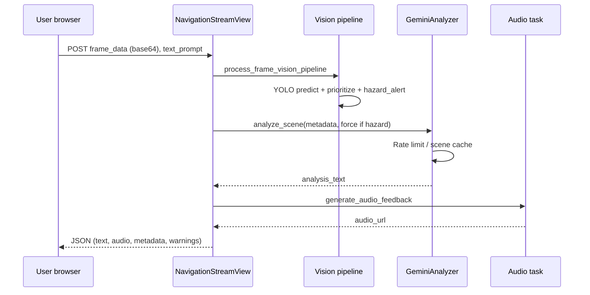

# Sightra — Technical Report

**Document type:** Internal technical & compliance report  
**Product:** Sightra assistive vision and navigation web application  
**Maintainer:** Sauti-Yetu engineering  
**Version baseline:** Repository `main` (Django MVP + Supabase auth + YOLO26n + Gemini)  
**Classification:** Internal — may contain operational guidance; no customer secrets in this file

---

## 1. Executive summary

Sightra helps blind and visually impaired users understand their immediate environment through **camera-based perception**, **object detection**, and **natural-language audio guidance**. The current production architecture is a **Django monolith** with server-rendered pages, a **Progressive Web App (PWA)** shell, **Supabase authentication**, **Ultralytics YOLO26n** for COCO-class detection, and **Google Gemini** for hazard-prioritized narration. Audio is generated server-side (e.g. pyttsx3) and returned to the client as URLs/text.

**Critical limitation (must be communicated to users):** Sightra is an **assistive aid**, not a certified mobility or medical device. Detection and language models can miss hazards, hallucinate, or lag. Users must retain white cane, guide dog, human assistance, and personal judgment as primary safety mechanisms.

---

## 2. System purpose and scope

### 2.1 In scope

- Real-time frame analysis for mobility-relevant objects (vehicles, people, furniture, etc.)
- Hazard-tier prioritization and spoken alerts
- User accounts (email + Google OAuth via Supabase)
- Dashboard and feature pages: vision, voice assistant UI, live map UI, volunteer connect UI, settings
- Optional model fine-tuning pipeline for mobility-focused COCO subsets

### 2.2 Out of scope (current MVP)

- Certified accessibility hardware integration (except standard browser camera/mic)
- Guaranteed sub-100ms latency at scale
- Full turn-by-turn GPS navigation backed by live routing APIs (route endpoint is mocked)
- On-device-only inference (YOLO/Gemini run server-side in default deployment)
- Formal FDA/CE medical device clearance

---

## 3. Architecture

### 3.1 Logical components

| Layer | Technology | Responsibility |
|-------|------------|----------------|
| Presentation | HTML templates, Tailwind CDN, `static/js/sightra.js` | UI, camera capture, API calls |
| API | Django REST Framework | JSON endpoints under `/api/*` |
| Auth | Supabase + custom session | `request.sightra_user`, protected routes |
| Vision | Ultralytics YOLO26n | Bounding boxes, class labels |
| Reasoning | Google Gemini (`gemini-3.1-flash-lite-preview`) | Safety-first natural language |
| Audio | pyttsx3 (+ audio app tasks) | WAV generation for responses |
| Data | SQLite (default) | Django models (e.g. user preferences) |
| Async (optional) | Celery + Redis | Configured; main stream path is sync |

### 3.2 Primary data flow (live vision)

### 3.3 Deployment topology (production)

- **Host:** cPanel Git deployment (`.cpanel.yml`) to path under `/home/sightran/sightra-main/sightra/`
- **Domain:** sightra.net (per project history)
- **Secrets:** Environment variables on host — not in git
- **Static assets:** Copied on deploy; WSGI serves Django

Alternative hosts (e.g. Render) must respect ephemeral filesystem, `$PORT` binding, and persistent DB/storage choices documented in operations runbook.

---

## 4. Codebase structure (detailed)

### 4.1 Django applications

| App | Key modules | Notes |
|-----|-------------|-------|
| `apps.accounts` | `middleware.py`, `services/supabase_client.py`, `session_service.py`, `views.py` | Supabase sign-in/up/OAuth; preferences API |
| `apps.core` | `services.py` (GeminiAnalyzer), `tasks.py` (analyze_frame_context) | Orchestrates vision + LLM |
| `apps.vision` | `services.py` (YoloObjectDetector), `priorities.py`, `tasks.py` | Tiers, hazard alerts, tests |
| `apps.navigation` | `views.py` (NavigationStreamView) | Main inference HTTP entry |
| `apps.audio` | TTS tasks | Response audio files |
| `apps.settings` | User settings API | |
| `apps.volunteer` | LiveKit token endpoint | Real-time volunteer feature scaffold |

### 4.2 Configuration entry points

- `sightra/sightra/settings.py` — apps, middleware, Celery, env loading
- `sightra/sightra/urls.py` — routes for pages and API includes
- `sightra/.env.example` — documented environment variables

### 4.3 Machine learning assets

| Asset | Location | Role |
|-------|----------|------|
| YOLO26n weights | `sightra/models/weights/yolo26n.pt` | Default detector (~5.5 MB, in repo) |
| Fine-tuned weights | `sightra/models/weights/sightra_yolo26n.pt` | Optional; produced by training |
| Training scripts | `sightra/ml/vision/` | download, train, validate |
| Dataset configs | `sightra/ml/vision/data/*.yaml` | coco128, coco, sightra_mobility |

---

## 5. Processes and workflows

### 5.1 Software development lifecycle

1. **Planning** — User stories tied to accessibility and safety acceptance criteria.
2. **Implementation** — Feature branches from `main`; Django apps + templates + static.
3. **Review** — PR review; mandatory consideration of hazard-priority regressions.
4. **Test** — `apps.vision.tests_priorities`, `apps.vision.tests_models`; manual vision smoke on `/vision/`.
5. **Deploy** — cPanel git pull / pipeline; migrate DB; verify env vars.
6. **Monitor** — Server logs, Gemini quota errors, YOLO load failures, auth errors.

### 5.2 Model update workflow

1. Train or validate in `ml/vision/` (see `ml/vision/README.md`).
2. Evaluate mAP and **mobility-critical class recall** on held-out data.
3. Copy approved weights to `models/weights/` with version note in PR.
4. Set `YOLO_MODEL_PATH` in staging, run A/B manual hazard scenarios.
5. Promote to production; document metrics in this report (section 8).

### 5.3 Prompt and safety rule changes

Gemini system prompt lives in `apps/core/services.py`. Changes require:

- Product + accessibility review
- Regression pass on hazard-first ordering (vehicles before decor)
- Update to section 7 (safety) and changelog in PR

---

## 6. Privacy and data protection

### 6.1 Categories of data

| Data | Source | Storage | Retention |
|------|--------|---------|-----------|
| Account identifiers | Supabase | Supabase + session cookie | Per Supabase project policy |
| User preferences | Django ORM | SQLite (default) | Until deleted |
| Video frames | User camera | Transient in HTTP request memory | Not persisted by default in MVP |
| Analysis text / audio | Generated | May be written as temp audio files | Ephemeral on server; depends on audio app config |
| API keys | Env vars | Server only | Rotated on compromise |

### 6.2 Third-party processors

- **Supabase** — authentication, JWT
- **Google (Gemini)** — scene narration from structured metadata (not full image in current default path for all calls—verify implementation when enabling vision upload)
- **Hosting provider** — application logs, TLS termination

### 6.3 Privacy principles implemented

- No commit of `.env` or service keys in git (`.gitignore`)
- Minimize frame retention (process in request lifecycle)
- Publishable Supabase key only in client-facing flows as intended by Supabase; service role server-only

### 6.4 GDPR / regional considerations (guidance)

- Maintain **Records of Processing Activities** referencing this document.
- Provide **privacy notice** to users: camera use, cloud AI, account data.
- Honor **data subject requests** via Supabase auth deletion + local preference deletion.
- **DPIA** recommended where deployment scales or stores frames/logs with PII.

### 6.5 Recommended privacy enhancements (backlog)

- Explicit consent modal before camera activation
- Configurable “no cloud LLM” mode (YOLO-only alerts)
- Audio file cleanup cron
- Audit log for admin access

---

## 7. Safety, bias, and fairness

### 7.1 Safety design intent

1. **Tiered priorities** (`apps/vision/priorities.py`): emergency/critical classes (e.g. cars, buses) outrank low-priority objects.
2. **Hazard alert string** prepended or merged into Gemini output (`build_hazard_alert`, `_merge_audio_message`).
3. **Gemini system rules** enforce stop/wait language for emergency/critical tiers first.
4. **Rate limiting / scene caching** reduces spam but **must not block** urgent refreshes (`force_refresh` when hazard present).

### 7.2 Known safety gaps

| Gap | Risk | Mitigation |
|-----|------|------------|
| Missed detection (YOLO) | User not warned of obstacle/vehicle | Disclaimers; audio “uncertain”; lower conf threshold tuning; fine-tune on mobility classes |
| False positive | Unnecessary stop/anxiety | Tier tuning; user feedback channel |
| Gemini softens urgent language | Under-warning | Mandatory hazard_alert merge; prompt rules |
| Latency | User moves before alert | Shorter prompts; smaller imgsz; edge deployment (future) |
| No depth sensor | Distance bands are heuristic | Label as approximate; avoid “3 meters” precision claims |
| Route guidance mock | Wrong navigation | Mark feature beta; integrate real routing API before production reliance |

### 7.3 Bias and fairness

**Object detector (COCO-trained):**

- Trained on Western-centric datasets; may underperform on uncommon vehicles, cultural objects, or diverse skin tones in “person” class.
- Class taxonomy reflects COCO labels—not all mobility hazards (e.g. open pit, wet floor sign) have dedicated classes.

**Language model (Gemini):**

- May reflect societal biases in phrasing; safety prompt reduces decorative focus but does not eliminate bias.
- English-first prompts; multilingual support not validated.

**Mitigation measures:**

- Document limitations in user manual
- Collect inclusive field testing with blind/VI community partners
- Fine-tune on `sightra_mobility.yaml` subset and local data (with consent)
- Periodic bias review when changing models or prompts

---

## 8. Model precision, accuracy, and performance

### 8.1 YOLO26n (default weights)

| Metric | Reference value | Context |
|--------|-----------------|--------|
| Architecture | YOLO26n | Ultralytics 8.3+ |
| Pretrained task | COCO object detection | 80 classes |
| Published COCO mAP (typical) | ~40.9 mAP50-95 (nano tier) | Vendor/docs benchmark; **not Sightra-specific** |
| Deployed conf threshold | `YOLO_CONF` default 0.35 | Tradeoff recall vs precision |
| Inference size | `YOLO_IMGSZ` default 512 | Latency vs accuracy |

**Sightra-specific accuracy** must be measured on internal validation sets (`ml/vision/validate.py`) after any weight or threshold change. Do not quote COCO mAP as end-user safety guarantee.

### 8.2 Gemini narration

| Aspect | Behavior |
|--------|----------|
| Model ID | `gemini-3.1-flash-lite-preview` |
| Input | Structured JSON of top detections + warnings + optional user query |
| Output | 1–3 short sentences for TTS |
| Caching | Scene fingerprint + 1.5s min interval (bypassed for urgent tiers / hazards) |

**Accuracy** is qualitative: alignment with hazard-first policy. Evaluate with scripted scenarios (vehicle center frame, chair blocking path, empty hallway).

### 8.3 Performance targets (engineering goals, not SLAs)

| Stage | Typical CPU server | Notes |
|-------|-------------------|-------|
| YOLO inference | ~200–800 ms | Depends on hardware, imgsz |
| Gemini API | ~300–1500 ms | Network + quota |
| TTS | ~100–500 ms | pyttsx3 local |
| End-to-end HTTP | 1–3 s | User-facing; optimize critical path |

Load testing and GPU deployment are recommended before high concurrency.

### 8.4 Monitoring metrics (recommended)

- YOLO `ready` flag and load errors (log count)
- Gemini error rate and latency p95
- HTTP 5xx on `/api/navigation/stream/`
- Auth failure rate
- Optional: user-reported “missed hazard” tickets tagged for ML review

---

## 9. Security

### 9.1 Threat summary

| Threat | Control |
|--------|---------|
| Secret leakage | `.env` gitignored; rotate keys if exposed in chat/logs |
| Session hijack | HTTPS only in prod; secure cookie flags (review Django settings hardening) |
| CSRF on forms | Django CSRF middleware |
| API abuse | Rate limiting at reverse proxy (recommended) |
| JWT forgery | JWKS verification via Supabase (session service) |

### 9.2 Production hardening checklist

- [ ] Replace insecure default `SECRET_KEY` in `settings.py`
- [ ] `DEBUG=False`, restricted `ALLOWED_HOSTS`
- [ ] HTTPS redirect, HSTS
- [ ] Separate Supabase service role from anon key
- [ ] Dependency scanning (pip-audit, Dependabot)

See [OPERATIONS_RUNBOOK.md](./OPERATIONS_RUNBOOK.md) for incident response.

---

## 10. User risks and mitigation measures

| User risk | Description | Mitigation |
|-----------|-------------|------------|
| Over-reliance on AI | User trusts audio over cane/dog | Manual: “assistive only”; training; repeated disclaimers in onboarding |
| Missed vehicle/obstacle | Model error | Hazard tiers; urgent merge; lower conf; fine-tune; fail-safe phrasing when empty detections |
| Distraction | Audio overload | Rate limit Gemini; short sentences |
| Privacy exposure | Camera in sensitive spaces | User education; mute/stop camera control in UI |
| Account compromise | Weak password | Supabase policies; OAuth option |
| Network loss | No guidance offline | PWA offline page; cache shell (limited) |
| Incorrect route info | Mock routing API | Label beta; disable until real API |

---

## 11. Accessibility

- High-contrast light/dark styling (`static/css/sightra.css`)
- Semantic HTML in templates; ARIA improvements ongoing
- Keyboard navigable auth forms
- Audio-first vision feedback design goal

**WCAG 2.2 AA** full conformance not yet certified—schedule formal audit.

---

## 12. Quality assurance

### 12.1 Automated tests

- `apps.vision.tests_priorities` — tier and hazard logic
- `apps.vision.tests_models` — weights file presence

### 12.2 Manual test matrix (minimum before release)

| Scenario | Expected |
|----------|----------|
| Sign up / sign in / Google OAuth | Session established; dashboard reachable |
| `/vision/` camera stream | JSON response with `analysis_text` |
| Large vehicle in frame | Emergency/critical language first |
| YOLO disabled | Degraded text-only behavior, logged error |
| Sign out | Protected routes redirect to sign-in |

---

## 13. Compliance and legal (non-exhaustive)

- **MIT license** for open-source components; verify third-party model licenses (Ultralytics, COCO, Gemini Terms of Use).
- **Accessibility laws** (e.g. ADA, EAA) may apply to public deployments—consult counsel.
- **AI transparency:** disclose use of automated vision and cloud LLM to users.

---

## 14. Document control

| Field | Value |
|-------|-------|
| Authors | Sauti-Yetu engineering |
| Review cycle | Quarterly or after major model/auth changes |
| Related docs | [USER_MANUAL.md](./USER_MANUAL.md), [OPERATIONS_RUNBOOK.md](./OPERATIONS_RUNBOOK.md), root [README.md](../README.md) |

**Change log**

| Date | Change |
|------|--------|
| 2026-10-15 | Initial comprehensive report for Django MVP + YOLO26n + Supabase + Gemini |
